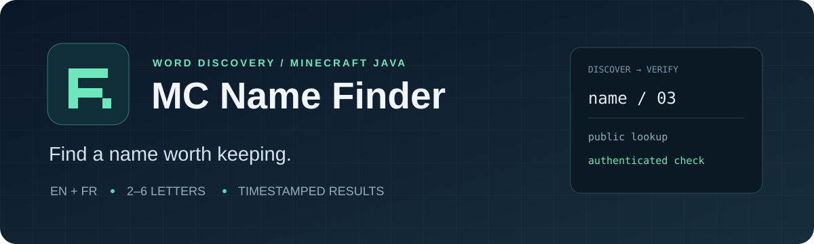

<p align="center">
  
</p>

<p align="center">
  <strong>English & French words. Minecraft Java names. Clear, timestamped answers.</strong>
</p>

<p align="center">
  <a href="https://github.com/Wuelass/mc-name-finder/actions/workflows/ci.yml"></a>
  
  <a href="LICENSE"></a>
  
</p>

<p align="center">
  <a href="#quick-start">Quick start</a> · <a href="docs/README.fr.md">Français</a> · <a href="docs/usage.md">CLI reference</a> · <a href="docs/authentication.md">Token setup</a> · <a href="CONTRIBUTING.md">Contributing</a>
</p>

## A short name, with a real word behind it

MC Name Finder turns English and French word candidates into Minecraft-compatible names, checks current profile occupancy in batches, then optionally confirms a shortlist using Minecraft Services. Explore 2–6 letters by default, preserve original spellings, and export results you can actually inspect.

**A missing profile is not proof of availability.** Public lookup reports `UNREGISTERED`; only an authenticated availability check can report `AVAILABLE`. Every observation carries its own UTC timestamp. Results are a snapshot, not a reservation.

- **Word discovery** — English/French corpora, accent normalization (`été → ete`, `cœur → coeur`), frequency filtering, or your own dictionary.
- **Two-stage verification** — fast public lookups first; authenticated confirmation only for names you choose.
- **Readable results** — Rich terminal progress, CSV/JSON reports, and separate text lists for each length.
- **Recoverable scans** — checkpoints, bounded retries, `Retry-After` support, and Ctrl+C saves.
- **Local token configuration** — `.env` support, no credentials in reports, no token needed for discovery.

This is a discovery tool. It does not rename your account, claim usernames, or implement Microsoft sign-in. It targets **Minecraft Java profile names**, not Bedrock gamertags.

## Quick start

Requires **Python 3.10+** and internet access for API checks. Clone the repository first:

```bash
git clone https://github.com/Wuelass/mc-name-finder.git
cd mc-name-finder
```

<details open>
<summary><strong>Windows · PowerShell</strong></summary>

```powershell
py -m venv .venv
.\.venv\Scripts\python.exe -m pip install -e .
Copy-Item .env.example .env
.\.venv\Scripts\mc-name-finder.exe scan --min-length 3 --max-length 6 --min-frequency 3 --limit 500
```

No PowerShell activation or execution-policy change is required.

</details>

<details>
<summary><strong>Linux / macOS</strong></summary>

```bash
python3 -m venv .venv
.venv/bin/python -m pip install -e .
cp .env.example .env
chmod 600 .env
.venv/bin/mc-name-finder scan --min-length 3 --max-length 6 --min-frequency 3 --limit 500
```

On Debian/Ubuntu, install your distribution's `python3-venv` package if venv creation is unavailable.

</details>

The commands below assume your virtual environment is activated. You can always substitute the explicit executable paths above, or run `python -m mc_name_finder`.

```bash
# All 2–6 letter candidates in the supported corpora
mc-name-finder scan

# Only French words of 4 letters
mc-name-finder scan --languages fr --min-length 4 --max-length 4 --output results/french

# Offline preview: generates candidates without contacting Minecraft
mc-name-finder scan --dry-run --limit 100 --output results/preview

# Continue a partial scan using its saved candidate selection
mc-name-finder scan --resume

# Use a fresh set of checks in an existing output directory
mc-name-finder scan --overwrite
```

A full corpus scan may take a long time. Start with a frequency filter and `--limit` to get a manageable shortlist. Two-letter words appear as `IMPOSSIBLE_LENGTH`: they cannot be registered as new Java usernames.

## Confirm your shortlist

Edit `.env` locally:

```dotenv
MC_ACCESS_TOKEN=your_minecraft_services_access_token
```

Then confirm candidates from the existing report:

```bash
# Highest-ranked unregistered names; does not rerun the public scan
mc-name-finder confirm --top 20

# Names you actually like, already present in results.json
mc-name-finder confirm --names example another

# Recheck a previously confirmed name to get a fresh observation
mc-name-finder confirm --names example --refresh
```

`example` and `another` are **command examples**, not claims that these names are free. Availability can change immediately after a check. Your ability to change a name is a separate account condition.

The token must be a **Minecraft Services access token**, without the `Bearer ` prefix. A Microsoft password, Microsoft OAuth token, or Xbox/XSTS token will not work. See [authentication](docs/authentication.md) for the distinction, safe setup, expiration, and troubleshooting. The `.env` file is ignored by Git; only `.env.example` belongs in the repository.

## Read the results

| Status | Meaning | Evidence |
|---|---|---|
| `UNKNOWN` | Public lookup has not completed | No availability conclusion |
| `IMPOSSIBLE_LENGTH` | Two-letter candidate | Excluded from new-name checks |
| `TAKEN` | An existing Java profile was returned | Public lookup |
| `UNREGISTERED` | No current profile was returned | May still be reserved or disallowed |
| `NOT_CHECKED` | No authenticated check yet | No exact availability conclusion |
| `AVAILABLE` | Minecraft Services accepted it as available at check time | Authenticated check |
| `DUPLICATE` | Minecraft Services reported it unavailable | Authenticated check |
| `NOT_ALLOWED` | Minecraft Services rejected the candidate | Authenticated check |

Outputs default to `results/`:

```text
results/
├── results.csv                       # UTF-8 BOM: spreadsheet-friendly
├── results.json                      # Checkpoint, source metadata and observations
├── NOTICE.txt                        # Attribution and interpretation notes
├── unregistered_3_letters.txt        # Public-lookup candidates, not confirmed free
├── available_exact_3_letters.txt     # Authenticated AVAILABLE observations
└── …                                 # One pair per represented length
```

`lookup_checked_at_utc` and `exact_checked_at_utc` describe individual checks. `exported_at_utc` describes file generation. A resumed scan keeps old observations; use a fresh scan or `confirm --refresh` when you need current information. Text lists omit timestamps, so read and share them with the corresponding report and notice.

## Word quality and coverage

The built-in source is [wordfreq](https://github.com/rspeer/wordfreq), a multilingual frequency corpus, **not an exhaustive dictionary of valid words**. It can contain proper names, abbreviations, slang and inflected forms. Normalization can also merge distinct words. `--min-frequency 3` prioritizes more common words; it does not guarantee dictionary membership.

For a strict selection, supply your own UTF-8 dictionary, one word per line:

```bash
mc-name-finder scan --words examples/words.txt --output results/custom
```

Custom input uses the same normalization, length filtering and deduplication. Blank lines and lines beginning with `#` are ignored. Digits, underscores, spaces, hyphens and apostrophes are excluded: this tool searches **word-based** names rather than all possible Minecraft usernames.

## API behavior

Public lookups send at most 10 names per request, with at least 1 second between requests. Authenticated confirmations are spaced at least 16 seconds apart. These are conservative defaults based on community-observed behavior, **not a guaranteed service quota**. Limits may change and other tools using the same IP/account consume the same allowance.

The client honors numeric and HTTP-date `Retry-After` headers, backs off on transient failures, and stops after four attempts. Authentication failures stop confirmation. Invalid JSON, unexpected response schemas and non-success responses are never interpreted as free names. Redirects are disabled so credentials remain on the intended endpoint.

Checkpoints are saved every 10 successful public batches and after each authenticated check. Normal completion, API failure and Ctrl+C export the latest in-memory observations. An abrupt power loss can discard progress since the last checkpoint. Run one process per output directory; pacing is per process, so avoid parallel confirmations with the same account.

## Development

```bash
python -m pip install -e '.[dev]'
ruff check .
ruff format --check .
pytest -q
python -m build
```

GitHub Actions runs linting, packaging and offline tests on Linux/Windows across Python 3.10, 3.12 and 3.13. Tests mock Minecraft Services; they never need a real token or consume API requests. See [contributing](CONTRIBUTING.md) and [architecture](docs/architecture.md).

## License and credits

Project code is [MIT licensed](LICENSE). wordfreq code and corpus data retain their own licenses; generated word-derived reports include attribution. See [THIRD_PARTY_NOTICES.md](THIRD_PARTY_NOTICES.md) before redistributing corpus-derived data. User-provided dictionaries retain their original terms.

Independent project by [Wuelass](https://github.com/Wuelass). Not affiliated with Mojang or Microsoft. Minecraft is a trademark of its respective owners.
